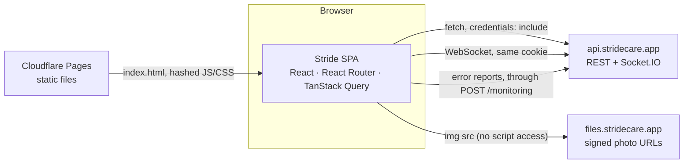
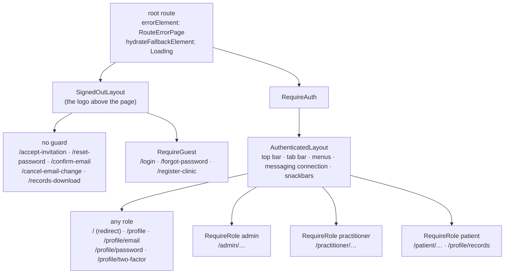

# Stride frontend: architecture

This document describes the frontend **as it stands**: what the parts are, how
they fit together, and the conventions every screen follows. It's a living
document, edited in place whenever the app changes. It keeps no history: the
history is in the [journal](journal/README.md), a frozen record of each phase
as it happened.

| For | Read |
|---|---|
| Why a decision was made, what was rejected | [`PROJECT.md`](PROJECT.md) and the [decisions log](stride-design-decisions.md) |
| The test suites: what they prove, how to run them | [`TESTING.md`](TESTING.md) |
| Building and serving it | [`DEPLOYMENT.md`](DEPLOYMENT.md) |
| The API it calls: routes, errors, who may call what | the backend's API reference (TODO-LINK) |
| The server side: data, row-level security, the audit trail | the backend's `ARCHITECTURE.md` (TODO-LINK) |

"Decisions §N" below means section N of
[`stride-design-decisions.md`](stride-design-decisions.md), the log where
every choice was recorded as it was made, with its reasons. The code's
comments cite it the same way.

Where this document and the code disagree, the code is right and this
document has a bug. Each section names its source files so it can be
checked.

---

## 1. What the frontend is

Stride runs a physiotherapy practice. **Admins** run its clinics and
accounts. **Practitioners** keep an exercise library, build program
templates, assign programs to their patients, write the medical file and
measure range of motion. **Patients** follow their programs session by
session, report pain and difficulty, and message their practitioners. One
account can hold several roles; the app shows one role at a time, and the
person switches between them.

The frontend is a single-page app: static files, built once, served as they
are. Everything it shows comes from the backend's REST API and its Socket.IO
connection, both authenticated by the same session cookie. It holds no
secret, and none of its checks is a security boundary: the backend decides
every permission again, in its services and in the database (§4).



The addresses chosen for the deployment are `https://stridecare.app` (this
app, on Cloudflare Pages) and `https://api.stridecare.app` (the API). Photos
are `` elements pointing at short-lived signed URLs the API hands out
(`files.stridecare.app`); the app never reads an image's bytes with
JavaScript, so storage needs no CORS rules.

| Layer | Choice |
|---|---|
| Language | TypeScript 6, `strict`, `erasableSyntaxOnly` (type annotations only, no TypeScript-generated code) |
| UI | React 19 |
| Routing | React Router 8, the data router (`createBrowserRouter`), every page loaded on demand |
| Server state | TanStack Query 5, one client for the app |
| Other state | Zustand 5, for the snackbars only; the address bar for filters |
| Forms | react-hook-form + zod schemas |
| Components | shadcn/ui (style `radix-nova`) over the `radix-ui` primitives; Tailwind CSS 4; lucide icons |
| Special-purpose | `@dnd-kit` (drag to reorder), `react-easy-crop` (the avatar), `socket.io-client` (messaging), `@sentry/react` (error reports) |
| Charts | hand-drawn SVG (no chart library) |
| Fonts | Geist by default, Atkinson Hyperlegible Next as a setting, both self-hosted (`@fontsource-variable`) |
| Build | Vite 8 (pinned to 8.3.5) with Rolldown |
| Tests | Vitest 5 + Testing Library in jsdom; Playwright 1.63 in Chromium ([`TESTING.md`](TESTING.md)) |
| Lint | oxlint, then ESLint with type-checked rules |

---

## 2. The source tree

```
src/
  main.tsx, App.tsx     start-up (§3)
  api/                  the one HTTP funnel, the query client, error wording (§5, §6)
  app/                  routes, guards, layouts, navigation, the three homes (§4)
  common/               shared components and pure helpers used by several areas
  components/ui/        shadcn's generated components (button, card, dialog, …)
  theme/                light / dark, the font setting, the palette's contrast check (§9)
  snackbars/            the confirmations and failures shown at the screen's edge (§8)
  observability/        browser error reports (§10)
  <area>/               one folder per area of the product
e2e/                    the browser suite (Playwright)
scripts/                build-time tools (address data, the cache-name check)
```

The **area folders** follow the backend's modules, so a screen's code sits
under the same name as the routes it calls:

| Area | Folders (`src/…`) |
|---|---|
| Accounts and sign-in | `auth`, `two-factor`, `invitations`, `password-change`, `email-change`, `users`, `clinics`, `patient-merges`, `demo` |
| Exercise programs | `exercises` (the library), `programs` (templates), `workouts` (the editor shared by templates and programs), `assigned-programs`, `sessions` (the patient's flow, with `sessions/timer`), `progress` (pain and mobility charts) |
| Patients and the clinical record | `patients` (roster and patient page), `team` (the patient's care team), `medical-files`, `range-of-motion`, `alerts` (the practitioner's "For review") |
| Messaging | `messages` |
| Record access and the audit trail | `records-export`, `complaint-reviews`, `legal-disclosures`, `audit-log` |

Inside an area, files are named by what they do:

| File | Holds | Example |
|---|---|---|
| `api.ts` | the area's requests, one small function each, and its query keys | `fetchConversations()`, `conversationQueryKey(id)` |
| `types.ts` | the answers' shapes, written by hand (§5) | `AssignedProgram`, `ScheduleSummary` |
| `use….ts` | one query or mutation hook: what to fetch, what to update in the cache afterwards | `useSendMessage`, `useUpdateSessionExercise` |
| `…Rules.ts` | **pure** decisions: no React, no network, no clock read (today is passed in) | `sessions/startRules.ts`, `messages/messageRules.ts` |
| `…Text.ts` | the words a rule's outcome is said in | `sessions/todayText.ts` |
| `schemas.ts` | the forms' zod schemas | `exercises/schemas.ts` |
| `…Page.tsx` | a page: one route | `SessionPage.tsx` |
| other `.tsx` | the page's sections and controls | `SessionPlayer.tsx`, `ExerciseStep.tsx` |
| `….test.ts(x)` | its tests, beside it | `startRules.test.ts` |

The split keeps the parts that decide something testable with plain values:
25 `…Rules.ts` files and many smaller helpers (`common/calendarDate.ts`,
`common/weight.ts`, `assigned-programs/scheduleChange.ts`…) hold the logic,
and the components mostly arrange what they return. Test helpers that several
files share (render helpers, fixtures, a fake socket, assertions) also live
beside the code, named `render….tsx`, `testData.ts`, `…Assertions.ts`,
`Fake….tsx` (see [`TESTING.md`](TESTING.md)).

The source is about 56,000 lines in 525 files (the shared test helpers
included), and about the same again in 277 test files. Comments are long on
purpose: they say why a line is the way it is, and cite the decision or the
bug that made it so.

---

## 3. Start-up

[`main.tsx`](../src/main.tsx), in order:

1. `installErrorReporting()` — the window's `error` and
   `unhandledrejection` listeners, from the first line, so an error in the
   first second is still reported (§10).
2. `installStaleChunkReload()` — one automatic reload when a page's file is
   missing after a new deploy (§11).
3. `QueryClientProvider` with the app's one `queryClient`
   ([`api/queryClient.ts`](../src/api/queryClient.ts)), then `ThemeProvider`
   (above the router, so the sign-in page follows the theme too), then
   `App`.

[`App.tsx`](../src/App.tsx) asks **who is signed in** once
(`useCurrentUser()`, a `GET /auth/me`), applies that account's font setting
(`useAccountFont()`), and shows a loading state until the answer is in.
Rendering the router before it would risk a flash of the wrong screen: the
sign-in page for someone signed in, or a page for someone who isn't.

Before any of this, an inline script in [`index.html`](../index.html) sets
the theme and the font classes on `<html>` from this device's stored copies,
so the first frame is drawn in the right colours and letters. It duplicates
the rules of `theme/theme.ts` and `theme/font.ts` (it runs before any module
can load); `theme/themeScript.test.ts` runs the real script against the
modules' rules so the two copies can't drift apart.

### Who is signed in

[`auth/useCurrentUser.ts`](../src/auth/useCurrentUser.ts) is the one source
of truth for the session, and it is a TanStack Query entry, not a store of
its own:

- **One fetch, ever.** The first component to call it starts the
  `GET /auth/me` (`prefetchQuery`, checked against the cache's own state).
  Every caller then observes the entry with `enabled: false`, so mounting
  and unmounting guards can never start another fetch. (Before this, several
  observers each re-armed a fetch and looped: 1,000 requests in 2 seconds.)
- **`null` means signed out**, `undefined` means not known yet. Sign-in,
  role switch and sign-out write the answer into this entry with
  `setQueryData`. The only other reads are deliberate: the pages that change
  the account's email, password or two-factor read it again as they open
  (`useRefreshedCurrentUser`), because two-factor may have been turned off
  on another device.
- **A switch of role or a sign-out drops every other query**
  ([`useSwitchRole.ts`](../src/auth/useSwitchRole.ts),
  [`useLogout.ts`](../src/auth/useLogout.ts)): `removeQueries` with a
  predicate that keeps only the current-user entry, then the new value is
  written into that same entry. No list fetched as a practitioner survives
  into the admin's screens, and the components watching the current user are
  told at once. (`queryClient.clear()` was tried first: it discarded the
  entry the components were subscribed to, and the header kept showing the
  old role.)

---

## 4. Routes, guards and layouts

The whole route table is one array in
[`app/routes.tsx`](../src/app/routes.tsx): 64 routes that load their page on
demand, plus the sign-in page and the `/` redirect.



- **Guards are layout routes.** A route with an element and no path renders
  for all its children, so `RequireAuth`, `RequireGuest` and `RequireRole`
  each wrap a group and decide whether its matched child renders at all.
  Signed out on a guarded page: to `/login`, carrying the way back. The wrong
  role: to `/`, which `DashboardRedirect` sends on to the role's own home
  (`roleHomePath()`, the one map of role → home).
- **`RequireRole` is a convenience, not a security boundary**
  ([`RequireRole.tsx`](../src/app/RequireRole.tsx)). It spares a person a
  screen that would only fail. Deleting it would open no hole: every route
  of the API checks the role and the record again.
- **The pages an email links to sit under no guard** (accepting an
  invitation, resetting a password, confirming or cancelling an email
  change, downloading a records copy): the person may have no password yet,
  or be unable to sign in, and a signed-in visitor is told what to do rather
  than bounced away. Each reads its token from the address **once** and
  removes it (`replace`), so it isn't left in the history. On load they at
  most check the link; nothing changes until the person presses a button, so a
  mail scanner opening the link changes nothing.
- **The way back after signing in belongs to its owner**
  ([`auth/returnPath.ts`](../src/auth/returnPath.ts)). It carries the id of
  the account that was signed in; `destinationAfterSignIn()`, used by both
  the sign-in page and `RequireGuest`, honours it only for that same account.
  The next person to sign in on that browser goes to their own home
  (decisions §40).
- **Code splitting.** Every page is `lazy: page(() => import('…'), (m) =>
  m.SomePage)`. The `page()` helper keeps each route one typed line: a
  misspelt export is a compile error. The shell stays static: the guards, the
  layouts, the redirect and the sign-in page (a signed-out visitor's first
  screen shouldn't wait for a second file). While a page's file downloads,
  the current page stays on screen with a thin bar under the header
  (`NavigationProgress`). `routes.test.ts` fails if a page is added
  statically.
- **A route can tell its layouts something** through its `handle`, read with
  `useMatches()`. One does today: Messages says it fills the screen
  (`FILLS_SCREEN`, [`layout/fillsScreen.ts`](../src/app/layout/fillsScreen.ts)),
  so the layout adds no room under it.

### The signed-in layout

[`AuthenticatedLayout.tsx`](../src/app/AuthenticatedLayout.tsx) draws the
frame of every signed-in page:

- **One breakpoint, Tailwind's `md` (768 px).** Below it: a top bar (logo,
  Settings, the account menu) and a tab bar fixed at the bottom, within thumb
  reach. From it up (tablets, desktops): the sections move into the top bar.
  Both navigations are always in the page; CSS alone shows one, so the first
  paint is right without measuring the window.
- **One list of sections per role**,
  [`layout/sections.ts`](../src/app/layout/sections.ts), read by both
  navigations. `sections.test.ts` holds its rules: five tabs at most, Home
  first and matched exactly, no Profile (it's in the account menu), every
  section inside the role's own addresses, every section a real route.
- **The room under every page** is set here once (the tab bar's height plus
  2 rem on a phone, 3 rem on a desktop, plus the phone's safe-area inset);
  pages add none of their own (decisions §47).
- **What outlives a page** lives here: the messaging connection, keyed by
  `<user id>:<role>` (§7), and the snackbars (§8).

---

## 5. Talking to the API

Every request goes through [`api/client.ts`](../src/api/client.ts). Nothing
else in the app calls `fetch` (a grep finds the one call).

- **`apiRequest<T>(path, { method, body })`** for JSON answers, and
  **`apiDownload(path, …)`** for a file (the records PDF: a `Blob`, plus the
  name from `Content-Disposition`). Both go through one private `send()`, so
  the parts that matter for every call can't drift apart:
  - `credentials: 'include'`: the session cookie goes with every request,
    across origins;
  - a JSON body gets `Content-Type: application/json`; a `FormData` body
    (uploads) gets none, so the browser writes the multipart boundary itself;
  - a refusal becomes an **`ApiError`**: the status, `messages` (the
    backend's array of sentences), `requestId`, `retryAfterSeconds` (from a
    `429`'s `Retry-After`) and the whole `body` for the few answers with
    extra fields (the sign-in's `roles`, a duplicate's matches). The body's
    shape is **checked**, not assumed: an HTML page from a proxy (a `502`
    while the API restarts) becomes an `ApiError` with that status and no
    words, never a `SyntaxError`;
  - `204` and empty bodies give `undefined` instead of a JSON parse error.
- **A `401` in the middle of a session** calls a handler that
  `app/routes.tsx` registers at start-up
  (`setUnauthorizedHandler`). The client knows nothing of React or the
  router; the place that creates the router wires the two together. The
  handler marks the user signed out in the cache, remembers why (one `401`
  explains a sign-out after five failed step-ups), and navigates to
  `/login` with the way back. The routine `401` of `GET /auth/me` for a
  signed-out visitor is excluded: it isn't an event.
- **The address of the API** is `VITE_API_URL`, written into the build
  (default `http://localhost:3000` for development). The socket uses the
  same constant, so REST and the live connection can't point at two
  backends.
- **Types are written by hand** (`<area>/types.ts`), each checked against the
  backend's code or a real answer. An OpenAPI generator was set up in
  Phase 0 and removed at the end of Phase 5: nothing used its output, because routes
  without a declared response produced empty types, and its peer dependency
  forced `--legacy-peer-deps` on every install.
- **The backend's CORS settings expose** the three response headers the app
  reads across origins: `X-Request-Id`, `Retry-After` and
  `Content-Disposition`. Without that, the browser hides them from
  JavaScript.

### The words of a failure

One function, `failureText(error)` in
[`api/apiErrors.ts`](../src/api/apiErrors.ts), turns any error into the
sentence a screen shows: the backend's own words for a refusal (it writes
them for people), "Something went wrong on our side. Try again in a moment."
plus an 8-character **reference** for a `5xx`, and "Check your connection"
when no answer came. The reference is the start of the request id, which
finds the request's log lines and its error report. A convention test
(`failureTextConvention.test.ts`) fails if any other file reads an error's
messages itself (decisions §23).

---

## 6. Server state

Almost everything on screen is server state, and it all lives in TanStack
Query's cache. There is no store mirroring it.

- **Defaults** ([`api/queryClient.ts`](../src/api/queryClient.ts)): an answer
  is fresh for 30 seconds; a failed read is retried twice, except a `401`,
  `403`, `404` or `429`, which would only fail again. A few queries set their
  own timing: the current user never goes stale, the admin home's numbers
  refetch every 60 seconds while the tab is visible.
- **Keys** are built in each area's `api.ts` and start with the area's
  prefix (`['conversations', …]`, `['care-team', id, …]`), so one
  `invalidateQueries` on a prefix refreshes everything below it. Related
  queries are nested on purpose: a care team's candidate list sits under the
  care team's key, so adding a member refreshes the "already on the team"
  flags too.
- **After a write**, a hook does one of two things: writes the answer into
  the cache (`setQueryData`) when the answer is the whole new record (most
  program and session routes answer with the full object for exactly this
  reason), or marks the affected lists stale. Most of this lives in the
  area's hooks, each saying which it does and why; a page that owns a single
  write (the sign-in page, a form page) does it in that write's `onSuccess`.
- **Optimistic updates, where waiting would be felt**: the patient's ticks,
  ratings and notes during a session, dragging exercises and photos into a
  new order, and the settings menu's switches. The pattern
  ([`sessions/useUpdateSessionExercise.ts`](../src/sessions/useUpdateSessionExercise.ts)
  explains it step by step): cancel any refetch on its way, write the guess,
  send the requests **one at a time** (a mutation `scope`), write the
  server's answer only when nothing newer is pending, and on failure put
  back only the fields that change touched. Everything else waits for the
  server, deliberately: sending a message, closing a program, a schedule
  change.
- **The address is state too.** Filters and pages of the users list and the
  audit log live in the query string
  ([`common/useAddressFilters.ts`](../src/common/useAddressFilters.ts)), so
  Back, a reload and a shared link show the same view. The hook remembers a
  click in React state until the navigation lands: under the data router a
  navigation is asynchronous, and a radio button flickered "unchecked" for
  20–60 ms without it.
- **One client-side store**, Zustand, holds the snackbars' list (§8): it is
  the one piece of state raised from anywhere (a hook, after its page has
  gone) and drawn in one place.

### Dates

A **calendar date** is a `YYYY-MM-DD` string throughout
([`common/calendarDate.ts`](../src/common/calendarDate.ts)), worked out from
the device's own day (`localDateString()`), never through a `Date` at
midnight UTC. The app sends the viewer's "today" with every request whose
answer depends on it (`?today=` on a program's summary, a session's
`localDate`), because the server can't know the patient's day. Arithmetic is
done at noon UTC, which no time zone can move to another day. The tests
include days that only a wrong version gets wrong when run in another zone
(`TZ=Europe/Paris`, `TZ=America/Montreal`); those runs are done by hand
([`TESTING.md`](TESTING.md)).

Moments (a message's time, an audit entry) are shown with `Intl` in the
browser's locale and zone.

---

## 7. Real-time messaging

Practitioners and patients have Messages; admins have none, and get no
connection.

- **One connection per signed-in identity.**
  [`MessagingConnectionProvider`](../src/messages/MessagingConnectionProvider.tsx)
  is mounted by the layout with a React `key` of `<user id>:<role>`. A role
  switch changes the key: React unmounts the old provider (its cleanup
  closes the socket) and mounts a new one. One socket never carries two
  identities; the backend also closes the old session's sockets on its side.
  It opens only once `/auth/me` has answered with a user, because the layout
  renders only then.
- **An adapter around the library.**
  [`messagingSocket.ts`](../src/messages/messagingSocket.ts) is the only file
  that knows `socket.io-client` exists. The rest of the app sees four typed
  methods (`onServerEvent`, `onConnectionChange`, `send`, `close`); tests pass
  a `FakeSocket` with the same four. The library is **loaded on demand** with
  a dynamic `import()`, so the sign-in page and the admin's screens never
  download it; the function still returns its interface synchronously and
  queues listeners until the library has arrived. WebSocket transport only,
  with the session cookie (`withCredentials`).
- **Events are written into the query cache.**
  [`messageCache.ts`](../src/messages/messageCache.ts) holds pure functions
  (a thread with a new message, a list with a conversation read…) and the
  appliers that call them for `newMessage`, `messageDeleted`,
  `conversationRead` and `conversationArchived`. The screens read only the
  cache; they don't know whether an update came from REST or the socket.
- **REST is the truth.** On every connection, the first one included,
  everything under `['conversations']` is marked stale and refetched. The
  server doesn't replay events a tab missed while offline or asleep; the
  refetch covers the gap.
- **A message is shown once the server has stored it.** Sending waits for the
  socket's acknowledgement ("Sending…", the text kept until it's stored, the
  server's reason on a refusal, 10 seconds before "not sent"). An optimistic
  send was considered and deferred (decisions §7).
- **Two panes on a desktop, one at a time on a phone**: Messages is a layout
  route (the list) with the open conversation as its child, and CSS decides
  what a phone shows.

---

## 8. Screens: the shared states and parts

Every screen follows the same few rules for what it says while loading, when
something fails, and after an action. Each rule has its component, and the
first three a convention test that names any file breaking it.

| State | Drawn by | Rule |
|---|---|---|
| Loading | [`common/Loading.tsx`](../src/common/Loading.tsx) | nothing for 200 ms (most answers come sooner), then a sentence or a skeleton in a `role="status"` region; skeletons for lists and the homes' cards; reduced motion respected (`loadingConvention.test.ts`) |
| A read failed | [`common/LoadError.tsx`](../src/common/LoadError.tsx), words from `common/loadErrorText.ts` | "Couldn't load X." with the reason and **Try again**, which refetches only the failed queries; after a retry that works, focus moves to the new content's heading (`loadErrorConvention.test.ts`) |
| A failure's words | `failureText()` (§5) | one wording rule for every refusal and every 5xx (`failureTextConvention.test.ts`) |
| A record hidden or missing | [`common/NotAvailable.tsx`](../src/common/NotAvailable.tsx), [`common/RecordNotFound.tsx`](../src/common/RecordNotFound.tsx) | a `404` on a program, session, conversation or file entry may be row-level security hiding it: "Program not available", with both possibilities said and links out; other records "… not found" |
| An action worked, or failed with nowhere on screen to say so | the snackbars, [`snackbars/`](../src/snackbars/) | `showSuccess()` / `showFailure()` from anywhere; drawn once by the layout with Radix Toast; at most 3; a success hides after 5–10 s by its length (paused on hover, focus or a background window), a failure stays until closed; focus is never moved there; emptied on sign-out and role switch (decisions §33) |
| A field's refusal | the form, next to the field | not a snackbar: it belongs where the person can fix it |

Other shared parts, in `common/` unless named:

- **Forms** use react-hook-form with a zod schema (`schemas.ts` per area).
  The schema checks what can be checked before sending; the backend's
  refusals are shown as they come, on the field when they name one. Where
  the frontend repeats a backend limit (titles 200 characters, an
  exercise's steps 1,000), it does so once, in a constant or a rules table
  (`common/titleLimit.ts`, `exercises/descriptionRules.ts`), so the two
  sides can be compared.
- **`EditableField`** and its kin (`EditableTags`, `EditableAddress`): a value
  shown read-only with Edit, then Save / Cancel. Profiles, clinics, templates
  and programs edit in place with them.
- **People and units**: `UserAvatar` (the photo, or initials on one of three
  tints picked from the user's id, also when the photo's URL has expired),
  `WeightValue` (a weight in the viewer's unit, the prescription beside it
  when converted).
- **Drag to reorder** (`@dnd-kit`) in the workout editor and the photo pages,
  always with a keyboard path and spoken announcements
  (`common/sortableAnnouncements.ts`).
- **Charts** (`progress/ScoreChart.tsx`, `range-of-motion/RomChart.tsx`) are
  SVG drawn by hand, each with a table twin holding the same values; the pain
  chart also has a readout under it (hover, tap or arrow keys).
- **`components/ui/`** holds shadcn's generated components. They are code in
  the repo (shadcn copies, it doesn't install), changed where needed; a native
  `<select>` (`common/NativeSelect.tsx`) is used where the platform's own
  picker is better, with its options themed for dark mode.

### Accessibility conventions

Followed on every screen, and checked by the tests where jsdom can see them:
every control has a name; focus moves deliberately after an action
(to the next item after a removal, to the content after a retry, back to the
link that opened a page when returning to it); status changes are announced
through live regions; colour never carries meaning alone (a dashed outline
and a hidden "(not one of your clinics)" go with a lighter badge); every
colour pair passes WCAG AA in both themes (§9); pages keep a 16 px gutter at
375 px.

---

## 9. Look: theme, palette, fonts

- **Tokens, not colours.** [`index.css`](../src/index.css) defines the palette
  as CSS variables in OKLCH, for light (`:root`) and dark (`.dark`), and
  Tailwind's `@theme inline` maps them to utility classes (`bg-primary`,
  `text-muted-foreground`). The brand: the logo's dark teal as the primary
  colour, coral as an accent only (never a button or text colour), warm
  greys (decisions §39).
- **Contrast is tested, not eyeballed.**
  `theme/paletteContrast.test.ts` reads the real `index.css` as text and
  checks every pair the screens use against WCAG AA in both themes (4.5:1 for
  text, 3:1 for a control's marks), with the colour maths in
  `theme/colorContrast.ts` (no package).
- **The theme belongs to the device**: light, dark or system, in
  `localStorage` (`stride-theme`), applied by `ThemeProvider` and by the
  pre-paint script (§3). "System" follows the operating system live.
- **The font belongs to the account.** "Easier-to-read font"
  (`readableFont`, a users column) follows the person to every device.
  `useAccountFont()` applies it and keeps a copy on the device
  (`stride-font`) **only while someone is signed in**, so the pre-paint
  script can draw the first frame in it; signing out, or a session the
  server refuses, removes the copy and restores the default. (A per-device
  setting was built first; one person's setting reached the next person on
  the same computer.) The switch is one CSS variable, `--app-font`,
  redefined by a class on `<html>`; a browser downloads only the font it
  uses.

---

## 10. Error reporting

The browser's errors are reported to the self-hosted GlitchTip, under the
rule the backend's logs and reports follow: **nothing that leaves the
browser names or locates a patient** (decisions §32).

- **Small and early, then the SDK.**
  [`observability/errorReporting.ts`](../src/observability/errorReporting.ts)
  is in the first download; the Sentry SDK (`@sentry/react`, ~90 kB) is
  loaded on demand by [`sentry.ts`](../src/observability/sentry.ts), the only
  file that imports it. Every report waits for it, so an error in the first
  second is sent a moment later rather than lost.
- **Three sources**: a page that crashed while rendering (React Router's
  error element, `RouteErrorPage`, reports it and shows its reference), an
  uncaught error, and an unhandled promise rejection. Expected failures
  aren't reports: an `ApiError` (the server reports its own `5xx`), the
  network, or a page file missing after a deploy (`reportRules.ts`).
- **The report is rebuilt from an allow-list**
  ([`reportScrub.ts`](../src/observability/reportScrub.ts)): the error's type,
  message (email addresses removed) and stack frames, three tags (where, the
  route's path without its query, the reference), the release. Everything
  else the SDK collects is switched off by name (`dataCollection`), its
  default integrations are off, and there are no breadcrumbs, no session
  replay, no tracing.
- **Sent to our own API**, `POST /monitoring` (the SDK's `tunnel`), which
  rebuilds the report again from its own allow-list, adds the session's user
  id, and passes it to GlitchTip, which isn't on the internet. The browser's
  copy of the rule keeps the data from leaving the page; the server's copy
  is the one that can't be bypassed.
- **Configuration is build-time**: `VITE_SENTRY_DSN` (unset = off, the
  default in development and every test; it must be the backend's
  `SENTRY_BROWSER_DSN`), `VITE_SENTRY_ENVIRONMENT`, `VITE_SENTRY_RELEASE`
  ([`errorReportingConfig.ts`](../src/observability/errorReportingConfig.ts)).
  A DSN isn't a secret: every visitor's browser has it.

---

## 11. Build and delivery

`npm run build` = `tsc -b` (the three TypeScript projects: the app, the Vite
config, the browser suite), then `vite build` into `dist/`.

- **Every file is named after its content** (`SessionPage-hv2Az1i5.js`), so a
  browser may cache it for ever: new content, new name. `index.html` is the
  one file without a hash, fetched again on every visit.
- **Three choices keep a deploy cheap for a returning visitor** (decisions
  §45):
  - every page is its own file (§4), and so are the two big libraries only
    some visitors need: `socket.io-client` (§7) and the Sentry SDK (§10);
  - React, React DOM and React Router are grouped in a `framework` file,
    whose name changes only when one of them is upgraded;
  - **an import map** (`build.chunkImportMap`): files import each other by a
    stable key, and `index.html` maps each key to the real hashed name.
    Without it, one changed page renamed 129 of 224 files (each importer's
    content holds the names it imports). With it, one. This option is
    **experimental** in Vite 8, which is why `vite` is pinned to an exact
    version: upgrading it is a deliberate step, followed by the browser suite
    and `npm run check:cache-names`.
- **Measured 2026-11-03** (`npm run check:cache-names`, which builds twice,
  changes one page, and compares): 224 files; one page changed renames 1;
  the first download is 12 files, 768.75 kB (235.44 kB gzipped), of which the
  main file is 205 kB (67 kB gzipped) and the framework 315 kB (99 kB).
- **A page file missing after a deploy.** A tab opened before a deploy asks
  for yesterday's file names. Vite fires `vite:preloadError`;
  [`app/staleChunkReload.ts`](../src/app/staleChunkReload.ts) reloads once, onto
  the new `index.html`, at most once per 10 seconds (remembered in
  `sessionStorage`, and not at all without it, so a reload can never loop).
  A second failure reaches `RouteErrorPage` ("Reload the page").
- **Address data is generated**, not imported: `npm run
  generate:address-data` copies the countries' codes and names and their
  states from `country-state-city` into two JSON files (640 → 125 kB), and
  `addressData.test.ts` fails when an upgraded library would change them.
- **Build-time settings** (`import.meta.env`, typed in `vite-env.d.ts` so a
  misspelt name is a compile error): `VITE_API_URL` and the three
  `VITE_SENTRY_…` (§10). Vite only exposes variables prefixed `VITE_`, and
  writes their values into the files: nothing secret belongs there.
- **Served as static files** from Cloudflare Pages
  ([`DEPLOYMENT.md`](DEPLOYMENT.md)). The app needs two things from the host:
  every unknown path answered with `index.html` (the router reads the
  address), and `index.html` itself not cached for long.

**Quality gates**, the same locally and in CI (§12): `tsc -b`, `npm run lint`
(oxlint, then ESLint with `recommendedTypeChecked`, React hooks and
react-refresh rules), `vitest run`, `vite build`, and the browser suite.

---

## 12. Open items before the deployment

The app hasn't been deployed with the backend yet. Known before it is:

- **The host's settings aren't in the repository.** Cloudflare Pages serves a
  single-page app when the build has no `404.html`, and its default caching
  of `index.html` and of `/assets/*` needs checking against §11's two needs;
  a `public/_headers` file would make them part of the repository.
  [`DEPLOYMENT.md`](DEPLOYMENT.md) settles both.
- **`VITE_API_URL`** must be set to `https://api.stridecare.app` in the
  build's environment, and **`VITE_SENTRY_DSN`** to the browser project's
  DSN (§10), or reporting stays off.
- **A Content-Security-Policy**, if one is added, must allow the two inline
  scripts in `index.html`: the pre-paint script, and the import map Vite
  writes (each by its hash).
- **CI is written and parked** until the repositories are public
  ([`.github/workflows/ci.yml`](../.github/workflows/ci.yml), decisions §38):
  a `checks` job and a `browser` job against the backend's `main`.
  `.github/` is listed in `.gitignore` while the repositories are private;
  on that day the line is removed and the workflow committed, with the
  other steps decisions §38 lists.

## 13. Deliberate limits

- **No offline mode.** No service worker, and no API answer kept between
  visits: the query cache lives in memory and is emptied on sign-out. Every
  screen needs the network.
- **English only.** Words are written in the code, many of them in `…Text.ts`
  files beside their rules; there is no translation layer. Dates and numbers
  follow the browser's locale.
- **One role at a time.** The active role belongs to the server-side
  session, which every tab of a browser shares.
- **Hand-written API types** (§5): a backend change that renames a field is
  caught by the browser suite and by review, not by the compiler.
- **Chromium only, in the browser suite**; Firefox, WebKit and an automated
  accessibility scan are deferred ([`TESTING.md`](TESTING.md)).
- **The frontend enforces nothing.** Guards, disabled buttons and hidden
  sections are about not showing a person what would fail. Every rule is the
  backend's.

---

## Where to go for "why"

The decisions log records each choice as it was made; [`PROJECT.md`](PROJECT.md)
gathers them by topic; the [journal](journal/README.md) tells each phase as
a story.

| Section | Decisions |
|---|---|
| §1–§2 Shape, stack, folders | §1 (layout and navigation), §45 (the bundle) |
| §3 Start-up, who is signed in | §1, §40 (the way back) |
| §4 Routes and layouts | §1, §2 (the patient's sections), §47 (the room under each page) |
| §5 The API, failures' words | §15 ("not available"), §23 (plain words for every failure), §32 (the reference) |
| §6 Server state, dates | §5 (schedules, dates as calendar days, optimistic session ticks), §11 and §29 (filters in the address) |
| §7 Messaging | §7 |
| §8 Shared states and parts | §15, §24 (loading and error states), §33 (snackbars), §6 and §36 (the two charts) |
| §9 Look | §39 (palette, logo, fonts), §47 (the avatars' tints) |
| §10 Error reporting | §32 |
| §11 Build and delivery | §45 (the framework file, the import map, socket.io on demand) |
| §12 CI | §34 (the browser suite), §38 (CI) |
